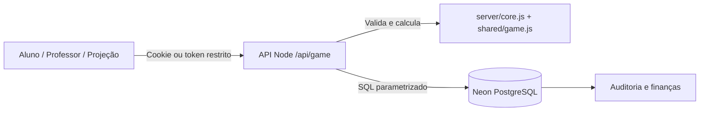

# Arquitetura e API

## Fluxo de confiança

O navegador envia intenções, nunca o saldo ou os tempos finais. A API identifica o usuário pela sessão guardada em cookie `HttpOnly`, `SameSite=Lax` e `Secure` em produção. A sessão contém um token aleatório; somente seu hash fica no banco. Senhas docentes usam `scrypt` com sal aleatório. Alunos recebem identidades anônimas próprias. A projeção usa apenas um token de leitura, comparado com hash no servidor, e não recebe dados privados da equipe.

As tabelas do Neon são acessadas somente pela API. A conexão de banco fica nas variáveis do servidor. Não há acesso SQL direto pelo navegador. Cada ação valida papel e vínculo com a sala. O backend recusa requisições de outra origem, limita tentativas de código e login e registra presença.

O estado operacional da sala é um JSONB versionado. `commit_game_room` bloqueia a linha, verifica versão, grava resposta idempotente, auditoria e eventos financeiros numa transação. Em conflito, o cliente repete a ação com o mesmo `requestId`. A classificação usa tempos calculados no servidor, nunca animação local. O polling HTTP consulta a sala a cada segundo; o relógio e os checkpoints são resolvidos no servidor.

## Ações `POST /api/game`

| Ação | Quem usa | Resultado |
| --- | --- | --- |
| `session`, `student-auth`, `teacher-login` | visitante | identidade/sessão |
| `create-room` | docente | sala, código, token de projeção |
| `join-room` | aluno | equipe na sala |
| `state` | membro ou projeção | visão filtrada |
| `team-action`, `equip-part`, `unequip-part` | equipe | profissionais e peças |
| `purchase-supply`, `refund-supply`, `assign-repair` | equipe | estoque e finanças |
| `run-test`, `submit-analysis`, `set-ready` | equipe | teste e análise |
| `market-action`, `room-transition`, `build-heats`, `build-final` | docente | andamento da aula |
| `race-action` | docente | controle da bateria |
| `sync-race` | membro | avanço oficial da corrida |
| `submit-qte` | aluno elegível | tentativa de QTE |
| `award`, `export-session`, `rotate-access` | docente | prêmios, CSV, acessos |

As mutações usam `requestId` UUID. A resposta inclui `ok`, `code`, `message`, `data` e, após commit, `current_version`.

## Fórmulas e pistas

Os atributos começam em `[35,35,30,30,40,40]`. Vetores de peça, piloto e auxiliar são limitados a 10–100. Scores e desgaste seguem o PRD e são implementados em `shared/game.js`; `npm test` verifica também a enumeração de 1.312 configurações viáveis e os líderes das três pistas.

Em salas novas, o professor define de 1 a 5 rodadas e de 1 a 5 voltas. Cada rodada classificatória distribui as equipes em baterias; a última rodada é a final quando há mais de uma. A final recebe até cinco equipes pelo menor tempo acumulado nas rodadas anteriores. Cada bateria encerrada credita prêmio por posição na mesma transação que grava o resultado. As equipes podem melhorar o carro após sua primeira bateria e até a largada seguinte. A simulação captura o projeto atualizado na largada e consome suprimentos por corrida.

Os duelos de reação surgem em `max(4, voltas × 3 + 1)` checkpoints distribuídos pela bateria. O servidor escolhe um par adjacente presente e alterna as oportunidades. O relógio lógico congela durante 1,6 s de preparação e 4 s de resposta. A primeira resposta válida recebida pelo servidor vence; diferenças de até 50 ms empatam. O efeito continua limitado a `−0,70/+0,15 s` para o perseguidor ou `−0,35/+0,20 s` para o líder. A interface mantém o aviso de QTE montado até o evento mudar.

O servidor sorteia incidentes no início da bateria. A confiabilidade do projeto pesa na escolha do carro e na chance de batida; rodadas e falhas acrescentam tempo, pausam o carro na animação e podem custar posições. Uma batida causa abandono. A agenda ainda não aplicada não é enviada aos clientes. Incidentes aplicados ficam no histórico oficial. O sorteio não altera a engine determinística dos testes de laboratório.

Para incluir uma pista, adicione-a a `CIRCUITS` em `shared/game.js`, eleve `VERSION` e adicione um teste de balanceamento. Salas antigas guardam `configVersion`, mas versões antigas da engine não são executadas em paralelo; evite mudar regras durante uma turma ativa.
